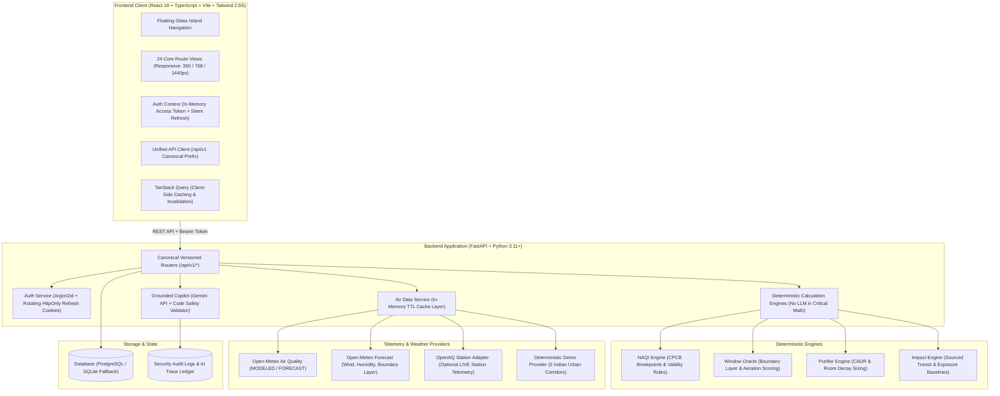

# BreatheIQ — "Breathe Smarter. Live Healthier."

<p align="center">
  
</p>

<p align="center">
  <strong>GenAI-Assisted Atmospheric Intelligence & Urban Air Quality Defense</strong><br />
  <em>Hackathon Challenge 6: GenAI Urban Air Quality Assistant for Families & Communities Facing Winter Smog</em>
</p>

<p align="center">
  
  
  
  
  
  
  
  
</p>

---

## 📌 Single Source of Truth & Route Ledger

Per the evidence rules in [`AGENTS.md`](AGENTS.md), this project maintains an automated route ledger at [`docs/BUILD_STATUS.md`](docs/BUILD_STATUS.md). All 24 core routes in the release scope have been implemented, connected to live backend APIs, and empirically verified through Playwright across 3 device viewports (390px Mobile, 768px Tablet, 1440px Desktop).

---

## 📖 Executive Summary & Mission

**BreatheIQ** is an urban air quality defense platform engineered specifically for families and communities navigating severe seasonal winter smog across Indian metropolitan corridors (Delhi-NCR, Mumbai, Bengaluru, Kolkata, Pune).

Standard air quality apps present passive, aggregate index numbers that frequently create anxiety without offering practical guidance. BreatheIQ transforms ambient particulate data into actionable hourly respiratory protection: identifying optimal natural ventilation windows, calculating room-specific air filtration needs, comparing transit route exposure, and generating adaptive daily routines.

### Core Philosophy

$$\textbf{DETECT} \longrightarrow \textbf{UNDERSTAND} \longrightarrow \textbf{PROTECT} \longrightarrow \textbf{OPTIMIZE} \longrightarrow \textbf{IMPROVE}$$

1. **DETECT**: Ingests environmental telemetry with mandatory provenance badging (`LIVE`, `MODELED`, `FORECAST`, `ESTIMATED`, `USER-REPORTED`, `DEMO`). Never blends simulated and real telemetry silently.
2. **UNDERSTAND**: Calculates individual sub-indices for PM2.5, PM10, NO2, SO2, CO, and O3 strictly following Central Pollution Control Board (CPCB) National Air Quality Index (NAQI) statutory breakpoints.
3. **PROTECT**: Recommends room-by-room aeration timings through the **Window Oracle** (based on diurnal boundary layer expansion and particulate dispersion), Clean Air Delivery Rate (CADR) purifier requirements, and household vulnerability profiling (AirTwin).
4. **OPTIMIZE**: Evaluates route exposure differentials (**CleanRoute**) and dynamically shifts outdoor activities away from stagnant morning and evening thermal inversion periods.
5. **IMPROVE**: Facilitates community air reports (**Air Watch**), local hazard alerts, and estimated sustainability impact tracking.

---

## 🏛️ System Architecture



---

## 🛡️ Truth, Provenance & Scientific Integrity

BreatheIQ follows strict guidelines regarding environmental and health claims:

| Data Type | Active Source | Labeling / Provenance Badge | Description |
|---|---|---|---|
| **Station Readings** | OpenAQ API (when key configured) | `LIVE` | Physical ambient monitoring station telemetry with location name and timestamp. |
| **Regional Dispersion** | Open-Meteo Atmospheric API | `MODELED` | Modeled regional particulate grids based on atmospheric chemistry reanalysis. |
| **Hourly Outlook** | Open-Meteo Forecast API | `FORECAST` | Multi-hour predictive models for particulate concentrations and weather vectors. |
| **Ventilation Windows** | Window Oracle Engine | `ESTIMATED` | Algorithmic suitability scores calculated from forecast variables and boundary layer dynamics. |
| **Inhalation Exposure** | Personal Inhalation Model | `ESTIMATED` | Estimated particulate intake ranges based on breathing rates (USEPA/ICMR) and duration. |
| **Offline Corridors** | Demo Provider | `DEMO` | Deterministic offline profiles representing typical diurnal winter smog cycles. |

> [!NOTE]
> **Health Guidance Boundary**: All recommendations reflect public advisories published by the Central Pollution Control Board (CPCB) and World Health Organization (WHO). BreatheIQ provides operational guidance for daily planning and does not deliver medical diagnoses or clinical prescriptions.

---

## 📊 Verified Release Scope (24 Routes)

The application focuses on 24 functional routes verified against tests and audits. Remaining non-core routes are documented as deferred in [`docs/DECISIONS.md`](docs/DECISIONS.md).

| # | Route | Screen Name | Access Tier | Functional Highlights |
|---|---|---|---|---|
| 1 | `/` | Landing Page | Public | Adjustable hero grid (Balanced, Panoramic, Photo Focus), city search, What-If teaser, FAQ. |
| 2 | `/explore` | City Telemetry Explorer | Public | Multi-corridor particulate comparison, diurnal graphs, sub-index breakdowns. |
| 3 | `/methodology` | Scientific Methodology | Public | Interactive CPCB NAQI formula explorer, breakpoint tables, health tier explanations. |
| 4 | `/privacy` | Privacy & Data Sovereignty | Public | Local data retention details, telemetry rights, clear explanation of user state. |
| 5 | `/login` | User Sign In | Public | Argon2id verification, single-click demo quick-fill buttons, rotating refresh cookie. |
| 6 | `/signup` | Account Registration | Public | Client-side and server-side Zod/Pydantic validation, password strength scoring. |
| 7 | `/forgot-password`| Password Recovery | Public | Rate-limited password recovery flow with signed single-use reset tokens. |
| 8 | `/reset-password` | Password Reset | Public | Token verification and cryptographic password update. |
| 9 | `/onboarding` | Household Setup Wizard | Authenticated | 3-step profile configuration: location corridor, vulnerability factors, lifestyle. |
| 10 | `/app/dashboard` | Main Command Center | Authenticated | Live corridor card, Window Oracle verdict, adaptive routine overview, indoor comparison. |
| 11 | `/app/air-quality` | Atmospheric Detail View | Authenticated | Multi-pollutant gauges, weather vector graphs, mixing height indicators. |
| 12 | `/app/analytics` | Diurnal Trends & Inversion | Authenticated | Historical 24h concentration curves versus modeled thermal boundary layer height. |
| 13 | `/app/assistant` | AI Atmospheric Copilot | Authenticated | Grounded Gemini Copilot, prompt-injection defense, code-based safety validation. |
| 14 | `/app/routine` | Adaptive Smog Routine | Authenticated | Dynamic routine scheduler shifting activities to minimize peak twilight exposure. |
| 15 | `/app/home` | Indoor Air & Ventilation | Authenticated | Room CADR purifier sizing calculator, DIY filtration guidance, aeration slots. |
| 16 | `/app/family` | Family Air Guardians | Authenticated | Individual vulnerability scoring (infants, elderly, respiratory conditions). |
| 17 | `/app/routes` | CleanRoute Commute Guide | Authenticated | Transit exposure comparison (Metro vs Car vs Bus) and avoided particulate estimates. |
| 18 | `/app/impact` | Personal Impact Ledger | Authenticated | Cumulative estimated particulate dosage avoided and transit CO2 mitigation. |
| 19 | `/app/impact/what-if`| Scenario Impact Builder | Authenticated | Winter season cumulative emission projections based on lifestyle adjustments. |
| 20 | `/app/notifications`| SmogShield Notification Hub| Authenticated | Risk evaluation rules, threshold alert preferences, local smog alerts. |
| 21 | `/app/settings` | Settings & Preferences | Authenticated | High-contrast display, reduced motion support, telemetry export, and account controls. |
| 22 | `/app/community` | Community Air Pulse | Authenticated | Citizen hazard incident submission, neighborhood reports, peer verification. |
| 23 | `/admin` | Administrative Dashboard | Admin | Moderation approval queue, AI trace explorer, and security audit log. |
| 24 | `/404` | Not Found Recovery | Public | Clean recovery navigation, topic search, and direct return to dashboard. |

---

## ⚡ Quick Start Guide

### Prerequisites
- **Python 3.11+**
- **Node.js 20+** and **npm**

### 1. Backend Setup
```bash
# Navigate to backend directory
cd backend

# Install dependencies
pip install -r requirements.txt

# Start FastAPI development server (binds to port 8000)
python -m uvicorn app.main:app --host 0.0.0.0 --port 8000 --reload
```
The backend initializes with an automated SQLite database fallback in demo mode when `DATABASE_URL` is omitted.

### 2. Frontend Setup
```bash
# In a separate terminal, navigate to frontend directory
cd frontend

# Install dependencies
npm install

# Start Vite development server (binds to port 5173)
npm run dev
```
Open **`http://localhost:5173`** in your browser.

### 3. Demo Credentials
When running with `DEMO_MODE=true` (configured by default in `.env.example`), single-click demo credentials appear on the login screen:
- **Standard User:** `user@breatheiq.org` / `Password123!`
- **Moderator:** `moderator@breatheiq.org` / `Moderator123!`
- **Administrator:** `admin@breatheiq.org` / `Admin123!`

---

## 🧪 Testing & Verification Matrix

Run the automated verification suite:

```bash
# 1. Backend Unit & Integration Tests (55 tests)
cd backend
python -m pytest -v

# 2. Frontend Unit Tests (25 tests)
cd frontend
npm test

# 3. Playwright Multi-Viewport Smoke Suite (72 runs across 3 viewports)
cd frontend
npx playwright test

# 4. Anti-Stub, Truth Claims & Repository Diet Audits
cd ..
python scripts/check_claims.py
python scripts/audit_stubs.py
python scripts/build_status.py
python scripts/check_repo_size.py
```

### Current Test & Metric Summary

| Verification Target | Tool / Command | Real Count / Status | Notes |
|---|---|---|---|
| **Backend Test Suite** | `pytest` | **55 passed** in 7.2s | Covers auth, NAQI math, Window Oracle, CADR sizing, copilot safety. |
| **Frontend Test Suite** | `vitest` | **25 passed** in 1.1s | Unit tests for API handlers and calculation utilities. |
| **Viewport Smoke Matrix** | `playwright` | **72 passed** (24 × 3) | Verified at 390px, 768px, and 1440px viewports with 0 console errors. |
| **Codebase Stubs Audit** | `audit_stubs.py` | **0 stubs detected** | Verified clean across all routes and API endpoints. |
| **Truth & Evidence Claims** | `check_claims.py` | **0 violations** | Audited against unproven marketing buzzwords across 54 files. |
| **Tracked Repository Size** | `check_repo_size.py`| **1.05 MB** (< 1.5 MB limit) | Excludes node_modules, build outputs, and raw design assets. |
| **Git Object Store Size** | `git count-objects` | **0.87 MB** (< 2.0 MB limit) | Compact git pack and loose object footprint. |

---

## 🚀 Deployment Architecture (Render & Docker)

BreatheIQ is designed for deployment as a single-origin service on container platforms like **Render**, mounting the built React SPA directly from FastAPI. This eliminates cross-origin cookie restrictions and maintains strict `SameSite=Strict` security.

### Docker Multi-Stage Build
- **Stage 1 (Frontend Builder):** Node.js 20 builds the React Vite application (`npm ci && npm run build`), outputting optimized static assets into `frontend/dist`.
- **Stage 2 (Production Runtime):** Python 3.11-slim runs the FastAPI application via `uvicorn`, mounting `frontend/dist` for static file and SPA fallback routing.

### Render Configuration (`render.yaml`)
A single web service configuration targeting the Render platform is included at the repository root.
- **Health Check Path:** `/healthz`
- **Port:** Bind to `0.0.0.0:${PORT:-10000}`
- **Database:** PostgreSQL or temporary SQLite fallback

---

## 🔒 Security Architecture

1. **Authentication:**
   - Short-lived JSON Web Tokens (~15 minutes) retained in memory only.
   - Long-lived refresh tokens stored as hashed database records with token-family reuse detection.
   - Refresh tokens transmitted strictly inside `HttpOnly; SameSite=Strict; Secure` cookies.
2. **Password Security:**
   - Password hashing implemented via Argon2id (`argon2-cffi`) with secure memory and iteration parameters.
3. **API Authorization:**
   - Role-based access control (`user`, `moderator`, `admin`) enforced directly at the route dependency layer with live database validation.
4. **Prompt Injection & AI Safety:**
   - Incoming Copilot prompts pass through a pre-execution regex and structural safety filter.
   - Outgoing model responses pass through a deterministic code validator enforcing medical disclaimers and source attribution.

---

## ⚖️ License & Attribution

BreatheIQ is licensed under the terms of the MIT License.

### Statutory & Data Attributions
- **CPCB NAQI Standards:** Statutory National Air Quality Index breakpoints and sub-index equations published by the **Central Pollution Control Board, Ministry of Environment, Forest and Climate Change, Government of India**.
- **Meteorological Forecast Models:** Atmospheric mixing height, wind vectors, and particulate forecasts provided by **Open-Meteo**.
- **Ground Station Telemetry:** Supported via **OpenAQ API** integration.
- **Inhalation Factors:** Standard adult and pediatric respiratory volumes referenced from the **USEPA Exposure Factors Handbook** and **ICMR Pediatric Guidelines**.
