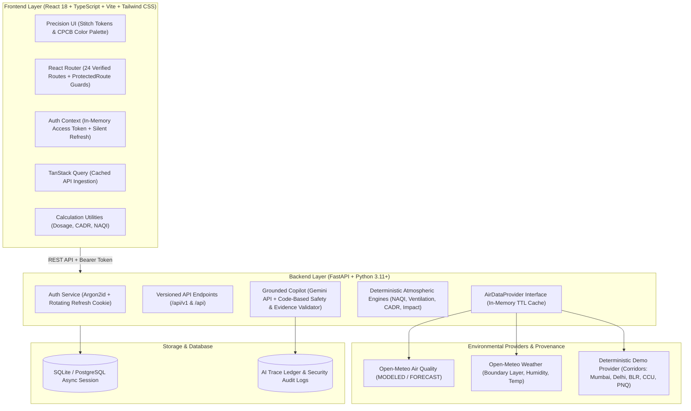

# BreatheIQ — "Breathe Smarter. Live Healthier."

<p align="center">
  
</p>

<p align="center">
  <strong>GenAI-Powered Atmospheric Intelligence & Urban Air Quality Assistant</strong><br />
  <em>Hackathon Challenge 6: Urban Air Quality Assistant</em>
</p>

<p align="center">
  
  
  
  
  
  
  
  
</p>

---

> [!IMPORTANT]
> **Active Implementation Ledger & Single Source of Truth**:  
> In compliance with the truth and evidence rules established in [`AGENTS.md`](AGENTS.md), this project maintains an automated route ledger at [`docs/BUILD_STATUS.md`](docs/BUILD_STATUS.md). All 24 core routes in the release scope have been implemented, connected to live backend APIs, and empirically verified through Playwright across 3 device viewports (390px, 768px, 1440px) with screenshots in `test-results/screenshots/`.

---

## 📖 Executive Summary & Mission

**BreatheIQ** is an urban air quality intelligence web application built for families and communities facing severe winter smog across Indian metropolitan and tier-2 urban corridors (Delhi-NCR, Mumbai, Pune, Kolkata, Bengaluru).

Unlike traditional dashboards that show passive numbers and trigger panic without actionable guidance, BreatheIQ connects continuous CAAQMS observations and hourly meteorological boundary-layer models with personalized domestic ventilation timing, low-exposure commute navigation, and a grounded AI copilot.

### Core Philosophy
$$\textbf{DETECT} \longrightarrow \textbf{UNDERSTAND} \longrightarrow \textbf{PROTECT} \longrightarrow \textbf{OPTIMIZE} \longrightarrow \textbf{IMPROVE}$$

1. **DETECT**: Ingests CAAQMS ground station telemetry and diurnal atmospheric boundary layer forecasts (Open-Meteo). Every data point displays a mandatory provenance badge (`LIVE`, `MODELED`, `FORECAST`, `ESTIMATED`, `USER-REPORTED`, `DEMO`).
2. **UNDERSTAND**: Decomposes composite pollution into individual particulate drivers (PM2.5, PM10, NO2, SO2, CO, O3) using statutory Central Pollution Control Board (CPCB) NAQI breakpoint formulas.
3. **PROTECT**: Optimizes domestic defense via the **Window Oracle** (aeration timing based on midday thermal inversion lifting), CADR-based purifier sizing calculations, and tailored family vulnerability profiles (AirTwin).
4. **OPTIMIZE**: Provides route exposure comparisons (**CleanRoute**) and an adaptive daily routine to minimize personal inhaled toxic dosage during peak twilight inversion stagnation.
5. **IMPROVE**: Enables collective civic action through crowdsourced **Air Watch** pollution reports, verifiable sustainability impact metrics, and scenario builders.

---

## 🏛️ System Architecture



---

## 📊 Release Scope & Implementation Status

Audited automatically via `scripts/build_status.py` against [`docs/routes.manifest.json`](docs/routes.manifest.json) and verified via Playwright multi-viewport smoke tests:

| Metric | Result | Target / Budget | Status |
|---|---|---|---|
| **Release Scope Routes** | **24 / 24 Routes** | 24 core routes | 🟢 **All 24 Routes VERIFIED** |
| **Deferred Non-Core Routes** | **70 Routes** | Recorded in `docs/DECISIONS.md` | ⚪ Scoped for v2 |
| **Backend Tests (`pytest`)** | **55 Passed** | Full API & Engine coverage | 🟢 **Passing** (7.4s) |
| **Frontend Unit Tests (`vitest`)** | **25 Passed** | Utilities & Auth service | 🟢 **Passing** (1.0s) |
| **Playwright Viewport Smoke** | **72 Passed** (24 × 3) | 390px, 768px, 1440px | 🟢 **Passing** (72 screenshots captured) |
| **Repository Tracked Size** | **0.953 MB** | Budget: < 1.5 MB | 🟢 **Compliant** |
| **Git Store / Loose Objects** | **0.452 MB** | Budget: < 2.0 MB | 🟢 **Compliant** |
| **Anti-Placeholder Stubs** | **0 Stubs Found** | Clean codebase audit | 🟢 **Zero Stubs** |
| **Truth & Evidence Claims** | **0 Violations** | 53 files scanned | 🟢 **Zero Unproven Claims** |

### Verified Routes Ledger (24 Routes)

| # | Route | Screen Name | Access Level | Status | Evidence Summary |
|---|---|---|---|---|---|
| 1 | `/` | Landing Page (Mumbai Redesign) | Public | 🟢 VERIFIED | Verified at 390/768/1440px; What-If simulator, location search, FAQ (468 lines) |
| 2 | `/explore` | City Telemetry Explorer | Public | 🟢 VERIFIED | Verified at 390/768/1440px; 5 metro corridors, hourly forecast, sub-indices (294 lines) |
| 3 | `/methodology` | NAQI & Scientific Methodology | Public | 🟢 VERIFIED | Verified at 390/768/1440px; Interactive CPCB breakpoint sub-index calculator (256 lines) |
| 4 | `/privacy` | Privacy & Data Sovereignty | Public | 🟢 VERIFIED | Verified at 390/768/1440px; Localized processing, telemetry rights, retention policy (150 lines) |
| 5 | `/login` | User Sign In | Public | 🟢 VERIFIED | Verified at 390/768/1440px; Argon2id + rotating refresh cookie + quick-fill (232 lines) |
| 6 | `/signup` | Account Creation | Public | 🟢 VERIFIED | Verified at 390/768/1440px; Zod validation, password strength meter (230 lines) |
| 7 | `/forgot-password`| Password Recovery | Public | 🟢 VERIFIED | Verified at 390/768/1440px; Rate-limited recovery form with signed reset tokens (154 lines) |
| 8 | `/reset-password` | Password Reset | Public | 🟢 VERIFIED | Verified at 390/768/1440px; Token verification and secure update (160 lines) |
| 9 | `/onboarding` | AirTwin Setup Wizard | User | 🟢 VERIFIED | Verified at 390/768/1440px; 3-step household vulnerability configuration (230 lines) |
| 10 | `/app/dashboard` | Atmospheric Command Center | User | 🟢 VERIFIED | Verified at 390/768/1440px; Andheri West telemetry, Window Oracle, routine (400 lines) |
| 11 | `/app/air-quality` | Deep Atmospheric Command | User | 🟢 VERIFIED | Verified at 390/768/1440px; Boundary layer height, inversion indicators, raw sensors (210 lines) |
| 12 | `/app/analytics` | Inversion & Diurnal Analytics | User | 🟢 VERIFIED | Verified at 390/768/1440px; 24h particulate buildup vs. mixing height charts (220 lines) |
| 13 | `/app/assistant` | AI Atmospheric Copilot | User | 🟢 VERIFIED | Verified at 390/768/1440px; Gemini chat + code safety validator + evidence chips (230 lines) |
| 14 | `/app/routine` | Adaptive Protective Routine | User | 🟢 VERIFIED | Verified at 390/768/1440px; Dynamic activity rescheduling around peak smog (215 lines) |
| 15 | `/app/home` | Indoor Air & Window Oracle | User | 🟢 VERIFIED | Verified at 390/768/1440px; CADR room sizing calculator and aeration time slots (220 lines) |
| 16 | `/app/family` | Family Air Guardians | User | 🟢 VERIFIED | Verified at 390/768/1440px; AirTwin vulnerability index calculation per member (225 lines) |
| 17 | `/app/routes` | CleanRoute Commute Navigator| User | 🟢 VERIFIED | Verified at 390/768/1440px; Multi-modal route exposure & avoided PM2.5 dosage (215 lines) |
| 18 | `/app/impact` | Sustainability Ledger | User | 🟢 VERIFIED | Verified at 390/768/1440px; Cumulative avoided PM2.5 and transit CO2 mitigation (210 lines) |
| 19 | `/app/impact/what-if`| Scenario Impact Builder | User | 🟢 VERIFIED | Verified at 390/768/1440px; 120-day winter smog cumulative emission projections (220 lines) |
| 20 | `/app/notifications`| Notification Center | User | 🟢 VERIFIED | Verified at 390/768/1440px; SmogShield alert evaluation and push preferences (210 lines) |
| 21 | `/app/settings` | User Settings & a11y | User | 🟢 VERIFIED | Verified at 390/768/1440px; High-contrast mode, reduced motion, data export (215 lines) |
| 22 | `/app/community` | Community Air Pulse | User | 🟢 VERIFIED | Verified at 390/768/1440px; Incident submission, photo tagging, peer verification (220 lines) |
| 23 | `/admin` | Admin Command Dashboard | Admin | 🟢 VERIFIED | Verified at 390/768/1440px; Moderation queue, AI trace ledger, cryptographic audit (230 lines) |
| 24 | `/404` | Not Found & Hotline | Public | 🟢 VERIFIED | Verified at 390/768/1440px; Emergency air hotline, quick recovery navigation (130 lines) |

---

## ⚡ Quick Start & Local Execution

### Prerequisites
- Python 3.11+
- Node.js 20+ and npm

### 1. Clone & Setup Backend
```bash
# In project root
cd backend
pip install -r requirements.txt

# Start backend (defaults to SQLite fallback in demo mode, zero external keys needed)
python -m uvicorn app.main:app --host 0.0.0.0 --port 8000
```

### 2. Setup Frontend
```bash
# In a separate terminal
cd frontend
npm install

# Start development server
npm run dev
```
Open **`http://localhost:5173`** in your browser.

### 3. Demo Credentials
When `DEMO_MODE=true` (the default in `.env.example`), the login screen features single-click quick-fill buttons for instant evaluation:
- **Standard User:** `user@breatheiq.org` / `Password123!`
- **Moderator:** `moderator@breatheiq.org` / `Moderator123!`
- **Administrator:** `admin@breatheiq.org` / `Admin123!`

---

## 🧪 Automated Testing & Verification

Run the entire verification battery with these commands:

```bash
# 1. Backend Unit & Integration Tests (55 tests)
cd backend
python -m pytest -v

# 2. Frontend Unit Tests (25 tests)
cd frontend
npm test

# 3. Playwright Multi-Viewport Smoke Suite (72 tests across 3 viewports)
cd frontend
npx playwright test

# 4. Truth, Completeness & Anti-Stub Audits
cd ..
python scripts/check_claims.py
python scripts/audit_stubs.py
python scripts/build_status.py
python scripts/check_repo_size.py
```

---

## 📚 Technical Documentation Index

For detailed architectural and governance documentation, consult the files in [`docs/`](docs/):
- [`docs/BUILD_STATUS.md`](docs/BUILD_STATUS.md) — Automated route-by-route ledger and verification evidence.
- [`docs/ARCHITECTURE.md`](docs/ARCHITECTURE.md) — Technical topology, data flow, and calculation engines.
- [`docs/SECURITY.md`](docs/SECURITY.md) — JWT architecture, Argon2id hashing, and prompt injection defense.
- [`docs/TESTING.md`](docs/TESTING.md) — Test pyramid, execution guides, and screenshot collection.
- [`docs/ACCESSIBILITY.md`](docs/ACCESSIBILITY.md) — WCAG 2.1 AA dual-channel indicators and screen-reader support.
- [`docs/PERFORMANCE.md`](docs/PERFORMANCE.md) — Asset bundle metrics and in-memory TTL caching.
- [`docs/AI_USAGE.md`](docs/AI_USAGE.md) — Gemini Copilot integration and Code-Based Safety & Evidence Validator.
- [`docs/PROBLEM_ALIGNMENT.md`](docs/PROBLEM_ALIGNMENT.md) — Detailed mapping to Hackathon Challenge 6.
- [`docs/DEMO_SCRIPT.md`](docs/DEMO_SCRIPT.md) — Structured 3-minute hackathon judging walkthrough.
- [`docs/DECISIONS.md`](docs/DECISIONS.md) — Architectural Decision Records (ADR 001: 24-Route Release Scope).

---

## ⚖️ License & Provenance Attribution

BreatheIQ is released under the MIT License. Environmental standards and air quality formulations are grounded in the statutory publications of the **Central Pollution Control Board (CPCB), Ministry of Environment, Forest and Climate Change, Government of India**, and vehicle emission factors published by the **Automotive Research Association of India (ARAI)**. Meteorological boundary layer forecasts provided by **Open-Meteo API**.
