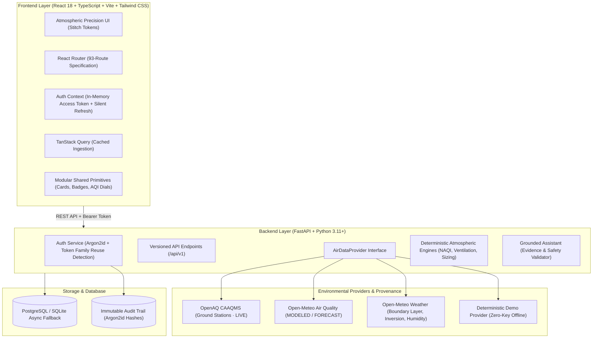

# BreatheIQ — "Breathe Smarter. Live Healthier."

<p align="center">
  
</p>

<p align="center">
  <strong>GenAI-Powered Atmospheric Intelligence & Urban Air Quality Assistant</strong><br />
  <em>Challenge 6 — Urban Air Quality Assistant</em>
</p>

<p align="center">
  
  
  
  
  
  
  
  
</p>

---

> [!IMPORTANT]
> **Active Implementation Ledger & Single Source of Truth**:  
> In compliance with the truth and evidence rules established in [`AGENTS.md`](AGENTS.md), this project maintains an automated route ledger at [`docs/BUILD_STATUS.md`](docs/BUILD_STATUS.md). Features are claimed only when backed by working code, automated stub audits, and verified test suites.

---

## 📖 Executive Summary & Mission

**BreatheIQ** is a full-stack urban air quality intelligence platform built for families and communities facing severe winter smog across Indian metropolitan and tier-2 urban corridors (Delhi-NCR, Mumbai, Pune, Kolkata, Bengaluru).

Most existing applications function merely as static dashboards or color-coded AQI checkers that generate panic without actionable agency. BreatheIQ connects continuous ground monitoring with meteorological boundary layer physics, domestic ventilation guidance, low-exposure commute navigation, and a grounded AI copilot.

### Core Philosophy
$$\textbf{DETECT} \longrightarrow \textbf{UNDERSTAND} \longrightarrow \textbf{PROTECT} \longrightarrow \textbf{OPTIMIZE} \longrightarrow \textbf{IMPROVE}$$

1. **DETECT**: Ingest official Continuous Ambient Air Quality Monitoring Stations (CAAQMS via OpenAQ) and diurnal atmospheric boundary layer forecasts (Open-Meteo). Every data point displays an explicit provenance badge (`LIVE`, `MODELED`, `FORECAST`, `ESTIMATED`, `USER-REPORTED`, `DEMO`).
2. **UNDERSTAND**: Decompose composite pollution into dominant particulate drivers (PM2.5, PM10, NO2, SO2, CO, O3) using statutory Central Pollution Control Board (CPCB) NAQI breakpoint formulas.
3. **PROTECT**: Optimize domestic defense via the **Window Oracle** (aeration timing based on midday thermal inversion lifting), air purifier CADR sizing calculations, and tailored family sensitivity profiles.
4. **OPTIMIZE**: Provide route exposure comparisons (**CleanRoute**) and an adaptive daily protective routine to minimize personal inhaled toxic dosage during peak twilight inversion stagnation.
5. **IMPROVE**: Enable collective civic action through crowdsourced **Air Watch** pollution reports, verifiable sustainability impact metrics, and habit trackers.

---

## 🏛️ System Architecture



---

## 📊 Current Implementation Status

Audited automatically via `scripts/build_status.py` against [`docs/routes.manifest.json`](docs/routes.manifest.json):

| Module Category | Total Routes | Verified | Functional | UI-Only | Stub | Missing |
|---|---|---|---|---|---|---|
| **Public Information** | 18 | 0 | 1 | 0 | 0 | 17 |
| **Auth & Onboarding** | 11 | 0 | 5 | 0 | 0 | 6 |
| **Core Application** | 32 | 0 | 1 | 0 | 0 | 31 |
| **Community Air Pulse** | 9 | 0 | 0 | 0 | 0 | 9 |
| **Atmospheric Learning** | 7 | 0 | 0 | 0 | 0 | 7 |
| **Admin Command Center** | 13 | 0 | 0 | 0 | 0 | 13 |
| **System & Fallback** | 3 | 0 | 1 | 0 | 0 | 2 |
| **Total** | **93** | **0** | **8** | **0** | **0** | **85** |

### Currently Working Screens & Features
- **Landing Page (`/`)**: Complete Mumbai Hero Redesign implemented from Google Stitch exports (`breatheiq_landing_page_mumbai_hero_redesign`). Includes:
  - Announcement bar with Winter Smog alert.
  - Multi-language switcher (`EN`, `HI`, `MR`) and sticky navigation.
  - Mumbai coastal skyline SVG background with Bandra-Worli Sea Link cable-stayed pylon artwork and marine haze drift.
  - Live Air Card with dynamic city search typeahead (Mumbai, Delhi, Pune, Bengaluru) updating live AQI, dominant pollutant (PM2.5), micro-pollutants, wind vector, and sparkline.
  - 8-card Feature Bento Grid (Copilot, Daily Routine, Window Oracle, Family Center, CleanRoute, SmogShield, What-If Simulator, Community Pulse).
  - Interactive **What-If Air Simulator** with live-updating sliders (Metro days, Carpool trips, induction cooktop toggle) calculating avoided inhaled PM2.5 in real-time.
  - Audience guidance tabs (Families, Schools, Communities) and interactive FAQ accordion.
- **Main Atmospheric Dashboard (`/app/dashboard`)**: Full desktop layout from Stitch (`breatheiq_main_dashboard_andheri_west_mumbai`). Includes:
  - Left collapsible navigation sidebar with 14 functional category links.
  - Top header with active station switcher and user profile capsule.
  - SmogShield Micro-Advisory banner with dismiss action.
  - Hero AQI Radial Dial (148 Moderate status) with granular PM2.5, PM10, NO2, and Marine wind cards.
  - Window Oracle indoor vs. outdoor HEPA comparison and recommended afternoon aeration window.
  - Interactive Daily Routine Checklist with toggleable task states and progress tracker.
  - CleanRoute commute exposure comparison card.
- **Authentication Suite (`/login`, `/signup`, `/forgot-password`, `/reset-password`, `/verify-email`)**:
  - JWT authentication with in-memory access tokens and rotating `HttpOnly` refresh tokens.
  - Argon2id password hashing and token-family reuse detection.
  - Demo quick-fill accounts pre-seeded for `user`, `moderator`, and `admin`.
- **System Error Handling (`/404`)**:
  - Accessible not-found view with search fallback, quick navigation chips, and emergency air hotline notices.

---

## 🎨 Design System & Stitch Assets

Visual styles and tokens are derived from Google Stitch exports stored in `Design file/stitch_breatheiq_urban_air_platform/`:

| Stitch Module Name | Route | Purpose |
|---|---|---|
| `breatheiq_atmospheric_precision` | `Tokens` | Design tokens (`DESIGN.md`): Plus Jakarta Sans, Inter, palettes, spacing, radii |
| `breatheiq_landing_page_mumbai_hero_redesign` | `/` | Complete public landing page |
| `breatheiq_login_a1` | `/login` | Split-screen authentication with demo quick-fill |
| `breatheiq_signup_a2` | `/signup` | User registration with intent selection |
| `breatheiq_forgot_password_a3` | `/forgot-password` | Password recovery with neutral responses |
| `breatheiq_reset_password_a4` | `/reset-password` | Password reset with token validation |
| `breatheiq_verify_email_a5` | `/verify-email` | OTP email verification flow |
| `breatheiq_main_dashboard_andheri_west_mumbai`| `/app/dashboard`| Core domestic atmospheric command center |
| `breatheiq_atmospheric_command_center` | `/app/air-quality` | Map layers, station clustering, and city comparison |
| `breatheiq_air_quality_inversion_analytics` | `/app/analytics` | Diurnal thermal inversion time series analytics |
| `breatheiq_ai_atmospheric_assistant` | `/app/assistant` | Conversational Copilot with evidence chips |
| `breatheiq_cleanroute_commute_navigator` | `/app/routes` | Multimodal route exposure comparison |
| `breatheiq_faq_knowledge_base` | `/faq` | Searchable FAQ with category filters |
| `breatheiq_contact_partnerships` | `/contact` | Validated contact form |
| `breatheiq_help_center_user_guides` | `/help` | User documentation and guides |
| `breatheiq_privacy_policy_terms` | `/privacy`, `/terms`| Legal documents with sticky table of contents |

### Color Tokens Palette
- **Primary**: Deep Forest Teal (`#005C55`), Primary Container (`#0F766E`), Mint Tint (`#DDF5EC`), Light Seafoam (`#9CF2E8`)
- **Secondary**: Marine Teal (`#216963`), Soft Green (`#A7E8C6`), Container (`#A8ECE5`)
- **Surfaces**: Canvas (`#F8FAF7`), Card Surface (`#FFFFFF`), Container Low (`#E3F8F6`), Container High (`#D8ECEA`)
- **Text & Outlines**: Charcoal (`#182A29`), Slate Muted (`#64748B`), Border Outline (`#E2E8F0`)
- **CPCB NAQI Categories**:
  - Good (0–50): `#2F9E62`
  - Satisfactory (51–100): `#7CB342`
  - Moderate (101–200): `#F2B705`
  - Poor (201–300): `#F28C28`
  - Very Poor (301–400): `#DC5252`
  - Severe (401–500): `#8B1E3F`

---

## ⚡ Atmospheric Engines & Methodology

### 1. CPCB NAQI Calculation Engine (`naqi.py`)
Computes official Indian National Air Quality Index sub-indices using statutory piecewise-linear breakpoint equations:
$$I_p = \frac{I_{hi} - I_{lo}}{B_{hi} - B_{lo}} (C_p - B_{lo}) + I_{lo}$$
- Evaluates standard statutory parameters: PM2.5, PM10, NO2, SO2, CO, O3, NH3, and Pb.
- Enforces validity rules: mandates a reading for at least one particulate pollutant (PM2.5 or PM10) plus at least two other gaseous pollutants before computing a composite AQI.

### 2. Window Oracle & Ventilation Engine (`ventilation.py`)
Models boundary-layer thermal inversion behavior from hourly forecast data:
- **Night & Morning (06:00–10:00)**: Surface radiation cooling traps vehicular and industrial emissions close to the asphalt. Status: **Seal Windows / Indoor Purification**.
- **Midday (13:00–16:00)**: Solar irradiance heats the surface, breaking the thermal lid and elevating the atmospheric boundary layer. Status: **Safe Ventilation Window**.

---

## 🔐 Security & Compliance

- **Authentication Architecture**:
  - Access Tokens: Short-lived (~15 min) JWT stored strictly in application memory.
  - Refresh Tokens: Stored in secure `HttpOnly` cookies with `SameSite=Strict` and SHA-256 token-family hashing in the database.
  - Token Reuse Detection: If an old or revoked refresh token is replayed, the entire session family is automatically invalidated.
  - Password Hashing: High-security `Argon2id` algorithm with configurable time and memory costs.
- **Repository Size Budget**:
  - The repository maintains an automated check (`scripts/check_repo_size.py`) ensuring tracked files remain strictly under 8.0 MB (currently at 0.52 MB).

---

## 🚀 Quickstart & Local Execution

### Prerequisites
- Python 3.11+
- Node.js 18+ and npm

### 1. Backend Setup
```powershell
cd backend

# Create and activate virtual environment
python -m venv .venv
.venv\Scripts\activate   # On Windows
# source .venv/bin/activate # On Linux/macOS

# Install dependencies
pip install -r requirements.txt

# Start FastAPI development server (bound to 0.0.0.0 for localhost support)
python -m uvicorn app.main:app --host 0.0.0.0 --port 8000
```
- API Documentation: [http://localhost:8000/docs](http://localhost:8000/docs)
- Health Probe: [http://localhost:8000/healthz](http://localhost:8000/healthz)

### 2. Frontend Setup
```powershell
cd frontend

# Install dependencies
npm install

# Start Vite dev server (bound to 0.0.0.0 for universal localhost resolution)
npm run dev -- --host 0.0.0.0 --port 5173
```
- Web Application: [http://localhost:5173/](http://localhost:5173/)

---

## 🔑 Pre-Seeded Demo Accounts

In development and demo modes, the database initializes with three standard role accounts:

| Role | Email | Password |
|---|---|---|
| **Standard User** | `user@breatheiq.org` | `Password123!` |
| **Community Moderator** | `moderator@breatheiq.org` | `Password123!` |
| **System Administrator** | `admin@breatheiq.org` | `Password123!` |

---

## 🧪 Testing & Verification Commands

All quality gates must pass before any new phase is committed:

```powershell
# 1. Verify repository size budget (< 8.0 MB)
python scripts/check_repo_size.py

# 2. Check for banned placeholder text, stubs, and empty event handlers
python scripts/audit_stubs.py

# 3. Audit all 93 routes and generate docs/BUILD_STATUS.md
python scripts/build_status.py

# 4. Run backend pytest suite (unit + auth tests)
cd backend ; python -m pytest tests -v ; cd ..

# 5. Typecheck and build frontend production assets
cd frontend ; npm run build ; cd ..
```

---

## 🗺️ Project Directory Structure

```
breatheiq/
├── AGENTS.md                  # Recovery Master Brief & Truth Rules
├── README.md                  # Truthful project documentation (this file)
├── docs/
│   ├── BUILD_STATUS.md        # Single Source of Truth Route Ledger
│   ├── SCREEN_SPECS.md        # 93-Route functional requirements library
│   ├── gap-report.md          # Architectural audit and baseline gaps
│   └── routes.manifest.json   # Machine-readable route definitions
├── backend/
│   ├── app/
│   │   ├── api/v1/            # Versioned API routers (auth, health)
│   │   ├── core/              # Security (Argon2id, JWT) and config
│   │   ├── db/                # Async database engine & demo seeds
│   │   ├── models/            # SQLAlchemy models (User, RefreshToken)
│   │   └── schemas/           # Pydantic v2 validation models
│   ├── requirements.txt       # Backend dependencies
│   └── tests/                 # Pytest test suite
├── frontend/
│   ├── src/
│   │   ├── components/ui/     # Design system primitives (Badges, Buttons, Cards)
│   │   ├── context/           # AuthContext & Session management
│   │   ├── pages/             # Page components (Landing, Dashboard, Auth)
│   │   ├── services/          # API client with silent token refresh
│   │   └── types/             # TypeScript interfaces
│   ├── public/                # Optimized logo derivatives (WebP, ICO)
│   ├── tailwind.config.js     # Stitch atmospheric design tokens
│   └── package.json           # Frontend dependencies
├── scripts/
│   ├── audit_stubs.py         # Anti-placeholder & stub scanner
│   ├── build_status.py        # Automated ledger generator
│   ├── check_repo_size.py     # Repository size budget gate (< 8.0 MB)
│   └── generate_manifest.py   # Route manifest generator
└── Design file/               # Stitch design exports (visual source of truth)
```

---
*For the complete 93-route specification, see [`docs/SCREEN_SPECS.md`](docs/SCREEN_SPECS.md). For live progress, see [`docs/BUILD_STATUS.md`](docs/BUILD_STATUS.md).*
