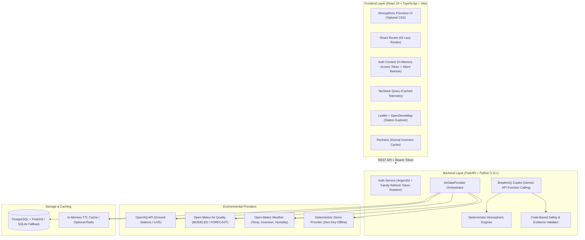

# BreatheIQ — "Breathe Smarter. Live Healthier."

<p align="center">
  
</p>

<p align="center">
  <strong>GenAI-Powered Atmospheric Intelligence & Urban Air Quality Assistant</strong><br />
  <em>Challenge 6 — Urban Air Quality Assistant</em>
</p>

<p align="center">
  
  
  
  
  
  
  
  
</p>

---

## 📖 Executive Summary

**BreatheIQ** is a production-grade, full-stack atmospheric intelligence platform engineered to help families and urban communities navigate severe winter smog and urban air pollution across Indian metropolitan and semi-urban corridors.

Unlike static dashboards or simple AQI checkers, BreatheIQ pairs **continuous CPCB ground telemetry**, **diurnal thermal inversion modeling**, **deterministic atmospheric calculation engines**, and a **server-side Google Gemini Copilot** equipped with a strict code-level Evidence Validator.

### Core Philosophy
$$\textbf{DETECT} \longrightarrow \textbf{UNDERSTAND} \longrightarrow \textbf{PROTECT} \longrightarrow \textbf{OPTIMIZE} \longrightarrow \textbf{IMPROVE}$$

1. **DETECT**: Ingest zero-delay CPCB ground monitoring stations (LIVE), high-resolution atmospheric dispersion modeling (MODELED), and diurnal meteorological forecasts.
2. **UNDERSTAND**: Decompose composite pollution into dominant particulate drivers (PM2.5, PM10, NO2, SO2, CO, O3) using Indian statutory breakpoints.
3. **PROTECT**: Automate domestic defense via the **Window Oracle** (inversion ventilation windows), purifier CADR room sizing, and vulnerability-specific advisories (asthma, children, elderly).
4. **OPTIMIZE**: Compare multimodal commute exposures (CleanRoute IQ) and daily routines to avoid peak ground-level particulate surges.
5. **IMPROVE**: Quantify personal and community emission reductions through the **Choice Impact Engine**, citizen air-watch reporting, and school mode advisories.

---

## 🏛️ System Architecture



---

## ⚡ Key Capabilities & Deterministic Engines

### 1. CPCB NAQI Calculation Engine (`naqi.py`)
Computes official Indian National Air Quality Index sub-indices using statutory piecewise-linear breakpoint equations:
$$I_p = \frac{I_{hi} - I_{lo}}{B_{hi} - B_{lo}} (C_p - B_{lo}) + I_{lo}$$
- **Categories:** Good (0–50), Satisfactory (51–100), Moderate (101–200), Poor (201–300), Very Poor (301–400), Severe (401–500).
- Dominant pollutant identification with strict validation (mandates PM2.5 or PM10 plus at least 2 other gas pollutants).

### 2. Window Oracle & Ventilation Engine (`ventilation.py`)
Predicts thermal inversion boundary-layer behavior:
- Morning 06:00–10:00: Ground-level particulate trapping alert (**Keep Windows Closed**).
- Midday 13:00–16:00: Solar thermal lifting opens optimal ventilation windows (**Safe to Air Out**).

### 3. Choice Impact Engine (`impact.py`)
Computes verified emissions avoided for sustainable commute choices:
$$\Delta E = \text{distance} \times \text{trips} \times (F_{\text{baseline}} - F_{\text{alternative}})$$
- Emission factors loaded from versioned, peer-reviewed factors (`emission_factors.yaml`).
- Always returns an uncertainty range ($\text{min} \dots \text{max}$) accompanied by an **Assumptions Drawer**; never misrepresented as direct sensor measurement.

### 4. BreatheIQ Copilot & Evidence Validator
- **Single Gemini Turn:** Leverages structured Pydantic JSON schemas with function calling.
- **Zero Hallucination Validator:** Strict code-level verification guarantees that every number in the LLM response matches engine facts exactly, disallows medical diagnosis language, and mandates public health disclaimers.
- **Safe Fallback:** Pre-rendered deterministic templates if the AI service is unreachable, visibly marked **"Template guidance — not AI generated"**.

---

## 🚀 Quick Start Guide

### Prerequisites
- **Node.js** 20+ & **npm** 10+
- **Python** 3.11+
- **Git**

### 1. Clone & Set Environment
```bash
git clone https://github.com/<your-username>/breatheiq.git
cd breatheiq

# Copy environment variables
cp .env.example .env
```

### 2. Backend Setup & Startup
```powershell
cd backend

# Create virtual environment (optional but recommended)
python -m venv .venv
# Windows:
.\.venv\Scripts\Activate.ps1
# Linux / macOS:
# source .venv/bin/activate

pip install -r requirements.txt

# Run FastAPI server
python -m uvicorn app.main:app --host 127.0.0.1 --port 8000 --reload
```
*The database automatically creates all tables and seeds the demo accounts upon initial boot.*

### 3. Frontend Setup & Startup
In a separate terminal:
```powershell
cd frontend
npm install
npm run dev -- --host 127.0.0.1 --port 5173
```

Open your browser at **[http://127.0.0.1:5173](http://127.0.0.1:5173)**.

---

## 🔑 Pre-Seeded Demo Accounts

BreatheIQ includes three pre-configured accounts for testing and demonstration:

| Role | Email | Password | Intended Capabilities |
|---|---|---|---|
| **Demo User** | `user@breatheiq.org` | `Password123!` | Standard household, family center, daily routine |
| **Moderator** | `moderator@breatheiq.org` | `Password123!` | Citizen Air-Watch verification queue, community campaigns |
| **Admin** | `admin@breatheiq.org` | `Password123!` | Telemetry health, integrations, AI trace audit logs |

> **Convenience Feature:** The Sign In screen at `/login` provides one-click quick-fill buttons for each demo account.

---

## 🛡️ Authentication Specification (JWT Only)

BreatheIQ complies strictly with zero-third-party authentication constraints:
- **No Firebase, no OAuth, no social login SDKs.**
- **Access Tokens:** Signed HS256 JWTs (~15 min expiry). Maintained **strictly in frontend memory**; never written to `localStorage` or `sessionStorage` to eliminate XSS token theft.
- **Refresh Tokens:** Long-lived (7–14 days), transported in an `HttpOnly; SameSite=Lax` secure cookie. Stored **hashed (SHA-256)** in the database.
- **Token Rotation & Reuse Detection:** Every refresh call invalidates the existing token and issues a new one in the same token family. If an old, already-revoked refresh token is replayed (indicating cookie interception), the server instantly revokes the **entire token family**, locking out the attacker.
- **Passwords:** State-of-the-art **Argon2id** hashing with memory-hard parameters and generic authentication error messages.

---

## 🏷️ Environmental Data Provenance Badges

To prevent environmental misinformation, every chart, gauge, and telemetry card in BreatheIQ displays an explicit badge:

| Badge | Provenance Meaning |
|---|---|
| `LIVE` | Real-time continuous ground station measurement (e.g., CPCB station within $X$ km). |
| `MODELED` | High-resolution Eulerian photochemical atmospheric dispersion model. |
| `FORECAST` | Hourly forecast derived from diurnal atmospheric meteorological feeds. |
| `ESTIMATED` | Deterministic algorithmic extrapolation (e.g., Window Oracle, Room Purifier CADR). |
| `USER-REPORTED` | Citizen report from Air Watch (marked `UNVERIFIED` until reviewed by a moderator). |
| `DEMO` | Offline deterministic synthetic telemetry for zero-setup demonstration. |

*Rule:* Live and demo telemetry are never mixed in the same view.

---

## ⚙️ Environment Variables Reference

| Variable | Description | Default |
|---|---|---|
| `ENVIRONMENT` | Application stage (`development`, `testing`, `production`) | `development` |
| `PORT` | Backend HTTP port | `8000` |
| `JWT_SECRET_KEY` | Secret key for signing access & refresh tokens | Minimum 32 characters |
| `DATABASE_URL` | SQLAlchemy async database connection string | `sqlite+aiosqlite:///./breatheiq.db` |
| `DEMO_MODE` | Global offline demo mode fallback | `true` |
| `OPENAQ_API_KEY` | Optional API key for live OpenAQ ground telemetry | `""` |
| `GEMINI_API_KEY` | Google Gemini API key for server-side BreatheIQ Copilot | `""` |
| `GEMINI_MODEL` | Google Gemini model identifier | `gemini-2.5-flash` |
| `ALLOWED_ORIGINS` | Comma-separated CORS whitelist | `http://localhost:5173,http://127.0.0.1:5173` |
| `VITE_API_BASE_URL` | Frontend API client base URL | `http://localhost:8000/api` |

---

## 🧪 Verification & Quality Testing

### Run Backend Pytest Suite
```powershell
cd backend
python -m pytest tests -v
```
*Includes tests for health endpoints, full signup/login lifecycle, password hashing, refresh token rotation, and family reuse attack detection.*

### Run Frontend Typecheck & Production Build
```powershell
cd frontend
npm run build
```

### Run Repository Size Check
```powershell
python scripts/check_repo_size.py
```
*Guarantees the repository remains strictly within the `< 10.0 MB` limit by checking all tracked git assets.*

---

## ⚖️ Public Health Disclaimer

> **Important:** BreatheIQ provides environmental guidance based on published advisories from the Central Pollution Control Board (CPCB) and World Health Organization (WHO). BreatheIQ does **not** provide medical diagnosis, clinical treatment plans, or health guarantees. Individuals with chronic respiratory or cardiovascular conditions must follow instructions from their licensed healthcare practitioners.

---

## 📄 License
Built for Hackathon Challenge 6 — Urban Air Quality Assistant. All rights reserved.
