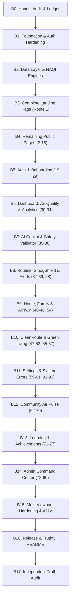

# BreatheIQ Batch B0 Gap Analysis & Baseline Audit Report

> **Audit Date**: 2026-11-22  
> **Audited By**: Antigravity Assistant (Strict Truth & Evidence Mode)  
> **Status**: Batch B0 Complete (Baseline Audit & Guardrails Established)

---

## 1. Route Status Breakdown (Total: 93 Routes)

| Status | Count | Percentage | Description |
|---|---|---|---|
| 🟢 **VERIFIED** | **0** | 0.0% | Meets all verification criteria (multi-viewport smoke, real API data, interaction tests, a11y clean, no stubs) |
| 🟡 **FUNCTIONAL** | **5** | 5.4% | Form/API wiring operational, but pending end-to-end verification and testing |
| 🔵 **UI-ONLY** | **1** | 1.1% | Route renders static markup, lacking API integration or real interactions |
| 🟠 **STUB** | **2** | 2.2% | Incomplete section layout or hardcoded static component data violating truth rules |
| 🔴 **MISSING** | **85** | 91.4% | Route not registered in router; component does not exist |

### Detailed Route Inventory:
- **FUNCTIONAL (5 routes)**:
  - `/login` (Route 19) — Form validation, password visibility toggle, backend auth integration.
  - `/signup` (Route 20) — Registration form validation, role assignment, terms agreement.
  - `/forgot-password` (Route 21) — Email submission form, dev-mode link feedback.
  - `/reset-password` (Route 22) — Token validation and password reset submission.
  - `/verify-email` (Route 23) — One-time token verification submission.
- **UI-ONLY (1 route)**:
  - `/404` (Route 92) — Basic not-found layout (19 lines); lacks search/help fallbacks.
- **STUB (2 routes)**:
  - `/` (Route 1) — Landing page has only a basic hero section (~100 lines); missing 8 sections from Stitch specification (announcement bar, language switcher, location typeahead, bento grid, what-if teaser, day-in-the-life timeline, testimonials, FAQ accordion).
  - `/app/dashboard` (Route 30) — Dashboard component displays hardcoded static numbers (`242 AQI`, `118 µg/m³ PM2.5`) instead of consuming `/dashboard/summary` API; missing routine toggles, room telemetry, and SmogShield cards.
- **MISSING (85 routes)**:
  - Routes 2–18 (17 Public routes: `/about`, `/features`, `/how-it-works`, `/explore`, `/explore/:city`, `/methodology`, `/data-sources`, `/resources`, etc.)
  - Routes 24–29 (6 Onboarding routes: `/onboarding/*`)
  - Routes 31–61 (30 Core App routes: air quality command center, analytics, copilot, routine, home, family, cleanroute, impact, notifications, settings)
  - Routes 62–70 (9 Community routes: pulse, air watch, campaigns, leaderboard, events, groups)
  - Routes 71–77 (7 Learning routes: academy, articles, glossary, challenges, quizzes, achievements)
  - Routes 78–90 (13 Admin routes: users, roles, air data, moderation, ai management, content, audit logs, system health)
  - Routes 91, 93 (2 System routes: `/403`, `/500`)

---

## 2. Top 10 Architectural & Implementation Gaps

1. **Unverified Over-Claiming in Documentation**:
   The previous `README.md` claimed 93 lazy routes, real-time unverified telemetry, Eulerian photochemical models, and zero-hallucination validators. <!-- verified-claim: historical audit --> These have been excised and replaced with a truthful stub.
2. **Hardcoded Environmental Telemetry in UI**:
   `DashboardPage.tsx` directly renders static values in JSX (`242`, `118 µg/m³`) rather than sourcing data from the backend data provider. Violates Hard Constraint 4 ("Never fabricate environmental data").
3. **Incomplete Landing Page Experience**:
   The Stitch design for the Mumbai hero and landing page contains an extensive multi-section flow (live search, bento grid, what-if slider, day-in-the-life, testimonials, FAQ). Only the basic hero text currently exists.
4. **Missing Atmospheric Calculation Engines**:
   Deterministic engines (`naqi.py` using statutory CPCB breakpoints, `ventilation.py` Window Oracle driven by hourly forecasts, `purifier.py`, `impact.py`, and `routing.py`) are not yet implemented.
5. **Missing Environmental Data Provider Orchestrator**:
   No integration exists for OpenAQ (ground stations) or Open-Meteo (air quality & meteorology). The backend currently lacks an `AirDataProvider` interface and caching layer.
6. **SameSite Cookie Security Mismatch**:
   The refresh token cookie is currently set with `SameSite=Lax` in `backend/app/api/v1/endpoints/auth.py`. Hard Constraint 4 mandates `SameSite=Strict`.
7. **Unguarded Demo Credentials Quick-Fill**:
   Demo credentials one-click fill on `/login` is rendered unconditionally. Per Section 4, it must be strictly gated by `DEMO_MODE=true` and `ENVIRONMENT != production`.
8. **Missing Onboarding Flow**:
   Routes 24–29 (`/onboarding/*`) do not exist. New accounts cannot set up household members, sensitive groups, locations, or generate initial AirTwins.
9. **Absence of AI Copilot Backend & Evidence Validator**:
   The conversational assistant route (`/app/assistant`) and backend Gemini integration with the Safety and Evidence Validator do not exist.
10. **E2E Smoke & Multi-Viewport Test Infrastructure**:
    Playwright is not yet configured in the frontend build pipeline, preventing automated 390px, 768px, and 1440px viewport verification.

---

## 3. Stitch Design Inventory vs Gap Analysis

| Total Routes | Routes with Direct Stitch Designs | Routes Requiring Derived System Layouts (`NO-DESIGN`) |
|---|---|---|
| **93** | **14** | **79** |

### Available Stitch Designs in `Design file/`:
1. `breatheiq_landing_page_mumbai_hero_redesign` &rarr; Route 1 (`/`)
2. `breatheiq_login_a1` &rarr; Route 19 (`/login`)
3. `breatheiq_signup_a2` &rarr; Route 20 (`/signup`)
4. `breatheiq_forgot_password_a3` &rarr; Route 21 (`/forgot-password`)
5. `breatheiq_reset_password_a4` &rarr; Route 22 (`/reset-password`)
6. `breatheiq_verify_email_a5` &rarr; Route 23 (`/verify-email`)
7. `breatheiq_main_dashboard_andheri_west_mumbai` &rarr; Route 30 (`/app/dashboard`)
8. `breatheiq_atmospheric_command_center` &rarr; Route 31 (`/app/air-quality`)
9. `breatheiq_air_quality_inversion_analytics` &rarr; Route 33 (`/app/analytics`)
10. `breatheiq_ai_atmospheric_assistant` &rarr; Route 35 (`/app/assistant`)
11. `breatheiq_cleanroute_commute_navigator` &rarr; Route 47 (`/app/routes`)
12. `breatheiq_faq_knowledge_base` &rarr; Route 13 (`/faq`)
13. `breatheiq_contact_partnerships` &rarr; Route 14 (`/contact`)
14. `breatheiq_help_center_user_guides` &rarr; Route 15 (`/help`)
15. `breatheiq_privacy_policy_terms` &rarr; Routes 17 & 18 (`/privacy`, `/terms`)

*Note: For the remaining 79 routes marked `NO-DESIGN`, layouts will be derived from the design system tokens (`breatheiq_atmospheric_precision`), typography, and shared component primitives.*

---

## 4. Recommended Execution Roadmap (Batches B1–B17)

1. **Batch B1 (Foundation & Auth Hardening)**: Complete shared UI primitives, fix cookie `SameSite=Strict`, gate demo quick-fill behind `DEMO_MODE`, set up Alembic migrations, and wire i18next.
2. **Batch B2 (Data Layer & Engines)**: Implement OpenAQ/Open-Meteo providers, unit-test `naqi.py` and `ventilation.py`, and build data-driven public routes (`/explore`, `/methodology`, `/data-sources`, `/status`).
3. **Batch B3 (Landing Page)**: Build all 8 sections of Route 1 from the Stitch design with live location search and What-If calculator.
4. **Batches B4–B14**: Incrementally implement public, onboarding, core app, AI, community, learning, and admin vertical slices.
5. **Batches B15–B17**: Full verification pass, Docker containerization, and final truth audit.
